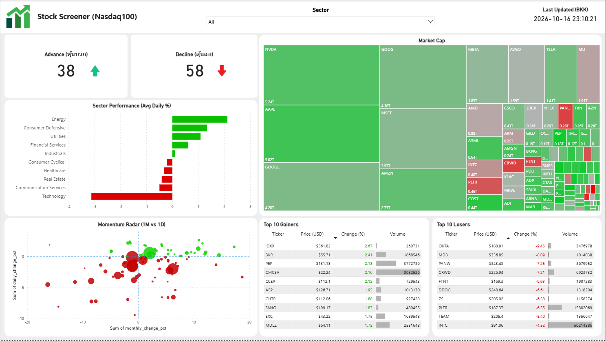
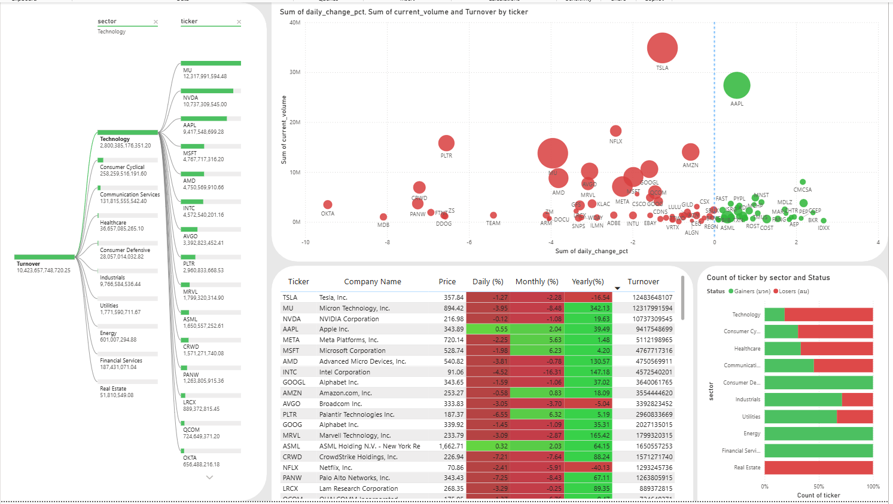

# 📈 Nasdaq-100 Market Intelligence & Stock Screener Dashboard

An end-to-end data analytics and automated pipeline project designed to track, transform, and visualize **Nasdaq-100 component stocks**.

Built using **Python, PostgreSQL, and Power BI**, this platform acts as a professional-grade market screener to analyze **daily performance, sector rotations, and institutional money flows**.

---

## 🏗️ System Architecture

```text
[ Yahoo Finance / Wikipedia ]
              │
              │ ETL Pipeline via Python
              ▼
[ PostgreSQL Database ]
              │
              │ Direct Connection / Automated Cron Schedule
              ▼
[ Power BI Desktop Dashboard ]
              │
              ├── Page 1: Market Overview
              │       └── Heatmap & Trends
              │
              └── Page 2: Deep Dive & Anomaly Detection
                      └── Matrix & Scatter Plot
```

---

## 🛠️ Technology Stack

### Data Extraction
- `python`
- `yfinance`
- `pandas`
- `requests`
- `io`

### Database Management
- PostgreSQL
- Local database
- Supabase cloud-ready

### Data Transformation & ETL
- Python
- Automated data cleaning
- Multi-timeframe percentage change calculations
- Market capitalization aggregation
- GICS sector mapping
- Robust fallback logic

### Visualization & Business Intelligence
- Power BI Desktop
- DAX measures
- Conditional Formatting
- Interactive Treemaps
- Decomposition Trees
- Advanced Scatter Plots

### Automation
- macOS Cron background scheduling

---

# 📊 Dashboard Pages & Features

## Page 1: Market Overview — The Macro Radar

Designed to give investors a bird's-eye view of market sentiment and major sector movements within seconds.

### Market Cap Treemap

Visualizes the entire Nasdaq-100 index where:

- Box size represents **Market Capitalization**
- Color represents **Daily Change %**
- Red/Green heatmap highlights daily performance
- Large-cap technology companies such as **Apple, Microsoft, and NVIDIA** accurately dominate the visual weight

### Sector Performance Bar Chart

- Ranks industry groups by average daily performance
- Helps reveal where capital is flowing across sectors

### Advance/Decline KPI Cards

- Tracks bullish vs. bearish stock counts
- Provides a real-time summary of market breadth
- Uses intuitive indicator arrows

### Momentum Radar — 1M vs. 1D Scatter Plot

Plots monthly performance against daily performance.

The visualization is divided into four key quadrants to identify:

- Trend continuation
- Potential reversal points
- Short-term momentum
- Medium-term momentum

### Top 10 Gainers & Losers Tables

Dynamic leaderboards highlighting:

- Top 10 gainers
- Top 10 losers
- Volume metrics
- Conditional formatting

---

## Page 2: Deep Dive & Money Flow — The Screener

Designed for thorough stock screening and institutional anomaly detection.

### Sector Decomposition Tree — AI-powered

Allows users to drill down hierarchically from:

```text
Total Market Turnover
        │
        ▼
   GICS Sector
        │
        ▼
   Stock Ticker
```

This allows users to explore market turnover from the overall market level down to individual stocks.

### Volume & Momentum Anomaly — Scatter Plot

Plots:

- **Daily Change %** against **Trading Volume**
- Bubble size dynamically represents **Turnover (Price × Volume)**

Designed to spot:

- Institutional accumulation
- Panic selling
- Sudden breakouts
- Unusual trading activity

### Multi-Timeframe Matrix

A comprehensive table tracking:

| Metric |
|---|
| Ticker |
| Company Name |
| Price |
| Daily (%) |
| Monthly (%) |
| Yearly (%) |
| Turnover |

Uses text-based conditional formatting for easier comparison.

### Sector Health Check — 100% Stacked Bar

Breaks down the internal health of each sector based on:

- Gainers
- Losers

This helps prevent false signals caused by single-stock outliers.

### Interactive Slicers

Fully responsive filters for:

- Sector
- Range

Filters synchronize relevant visuals instantly.

---

# 🖼️ Dashboard Preview

## Page 1 — Market Overview



---

## Page 2 — Deep Dive & Money Flow



---

# ⚙️ ETL Pipeline

The project uses a Python-based ETL pipeline to extract, transform, and load Nasdaq-100 market data.

## Extract

The extraction process retrieves:

- Stock prices
- Trading volumes
- Market capitalization
- Nasdaq-100 / Wikipedia data

The extraction process uses robust fallback logic.

### Tools

```text
yfinance
pandas
requests
io
```

---

## Transform

The transformation process handles:

- Data cleaning
- Daily percentage change calculations
- Monthly percentage change calculations
- Yearly percentage change calculations
- Market capitalization merging
- GICS sector mapping
- Robust fallback logic

---

## Load

The loading process:

- Establishes a secure PostgreSQL database connection
- Loads transformed market data
- Uses bulk loading
- Uses Replace mode

---

## Main Pipeline

The entire ETL process is orchestrated through:

```text
src/main.py
```

The overall workflow is:

```text
Extract
   │
   ▼
Transform
   │
   ▼
Load
   │
   ▼
PostgreSQL
   │
   ▼
Power BI
```

---

# 📁 Project Structure

```text
Nasdaq100_screener_project/
│
├── .env
│   └── Environment variables (Database credentials)
│
├── .gitignore
│   └── Git ignore rules
│
├── README.md
│   └── Project documentation
│
├── requirements.txt
│   └── Python dependencies
│
├── src/
│   ├── __init__.py
│   │   └── Package initializer
│   │
│   ├── config.py
│   │   └── Configuration parameters (URLs, periods)
│   │
│   ├── extract.py
│   │   └── Extracts stock prices, volumes,
│   │       market caps & Wikipedia data
│   │
│   ├── transform.py
│   │   └── Cleans data, calculates daily/monthly/yearly
│   │       returns, and merges market caps
│   │
│   ├── load.py
│   │   └── Handles secure database connection
│   │       and bulk loading (Replace mode)
│   │
│   └── main.py
│       └── Orchestration script for the entire ETL process
│
└── dashboard/
    ├── stock_screener.pbix
    │   └── Power BI Dashboard
    │
    └── images/
        ├── market_overview.png
        │   └── Page 1 Dashboard Screenshot
        │
        └── deep_dive_screener.png
            └── Page 2 Dashboard Screenshot
```

---

# 🔄 End-to-End Workflow

```text
Yahoo Finance / Wikipedia
          │
          ▼
     Python ETL
          │
          ├── Extract
          │
          ├── Transform
          │
          └── Load
          │
          ▼
    PostgreSQL Database
          │
          ▼
      Power BI Desktop
          │
          ├── Market Overview
          │
          └── Deep Dive & Money Flow
```

---

# 📌 Key Analytics

The dashboard focuses on the following areas:

- Nasdaq-100 component stock performance
- Daily performance
- Monthly performance
- Yearly performance
- Market capitalization
- Trading volume
- Turnover
- Sector performance
- Advance/Decline
- Momentum
- Volume & momentum anomalies
- Sector health
- Market turnover

---

# 🧰 Core Technologies

```text
Python
│
├── yfinance
├── pandas
├── requests
└── io

PostgreSQL

Power BI
│
├── DAX
├── Treemap
├── Decomposition Tree
├── Scatter Plot
├── Matrix
├── Bar Chart
└── 100% Stacked Bar

Automation
└── macOS Cron
```

---

# 📈 Project Flow

```text
        DATA SOURCES
   ┌─────────────────────┐
   │ Yahoo Finance       │
   │ Wikipedia           │
   └──────────┬──────────┘
              │
              ▼
        PYTHON ETL
   ┌─────────────────────┐
   │ Extract             │
   │ Transform           │
   │ Load                │
   └──────────┬──────────┘
              │
              ▼
       POSTGRESQL
   ┌─────────────────────┐
   │ Market Data         │
   │ Stock Data          │
   │ Sector Data         │
   └──────────┬──────────┘
              │
              ▼
        POWER BI
   ┌─────────────────────┐
   │ Market Overview     │
   │ Deep Dive           │
   │ Anomaly Detection   │
   └─────────────────────┘
```